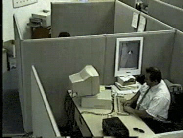

# Архитектура Компьютера

## Основная информация

Ну, готовьтесь страдать. Вас ждет незабываемые полгода веселья и зубрежки материала, который наполовину к курсу не относится.

Курс меняется в рантайме

## Экзамен

НОРМАЛЬНО РАСПИСАНЫЕ БИЛЕТЫ [ЗДЕСЬ](https://github.com/SE-Itmo-Labs/csa-sem4-exam-2026).

## Полезные источники

1. Страница с курсом [здесь](https://gitlab.se.ifmo.ru/computer-systems/csa-rolling)

## Рекомендуемая литература (она есть  [ЗДЕСЬ](https://github.com/SE-Itmo-Labs/csa-sem4-exam-2026))
1. Харрис и Харрис!
2. Танебаум - остаточные штуки, которых нет в Харрисе
3. Stack computers: new wave, так по-моему
4. Статья про NISC
5. Прочие статьи-первоисточники, где разбирались различные архитектуры